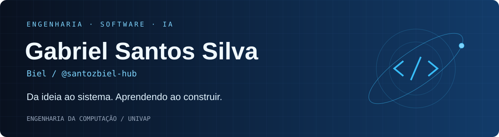

## Gabriel Santos Silva

Estudo Engenharia da Computação na Univap. Desenvolvo sistemas web e assistentes em Python e me interesso por redes, automação e software que precisa funcionar mesmo com conexão instável.

## Projetos em destaque

| Projeto | Problema e solução |
| --- | --- |
| [Inspeção de Frota](projetos/inspecao-de-frota.md) | Checklist para caminhões que registra a inspeção mesmo quando o sinal cai. O estudo de caso explica a fila local e a sincronização. |
| **ARIA** | Assistente pessoal em Python com terminal e API, integração com provedores de modelos e memória de sessão. |
| **Contraband** | Conceito de jogo FPS multiplayer em Unreal Engine, com duas facções e direção visual própria. |

## Código aberto para explorar

- [Algoritmos e VisuAlg](https://github.com/santozbiel-hub/Lista_1_VisuAlg) · Listas de lógica, fluxogramas e o desafio MedControl, com um guia das funções.
- [LabX](https://github.com/santozbiel-hub/Unity-Biologia) · Projeto acadêmico de um laboratório de biologia em realidade virtual no Unity.
- [CS50](https://github.com/santozbiel-hub/learning-cs50) · Caderno de estudos de fundamentos.

**Tecnologias:** Python, JavaScript, TypeScript, React, Next.js, Git, PostgreSQL e Supabase.

### Atividade no GitHub

O [script de estatísticas](scripts/profile_stats.py) consulta o GitHub e grava os cartões. O [módulo de métricas](scripts/profile_metrics.py) calcula as sequências de contribuição a partir do calendário já carregado.
